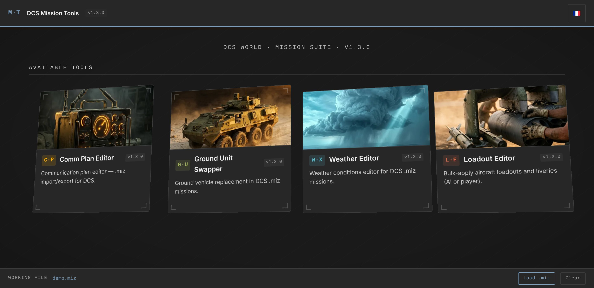
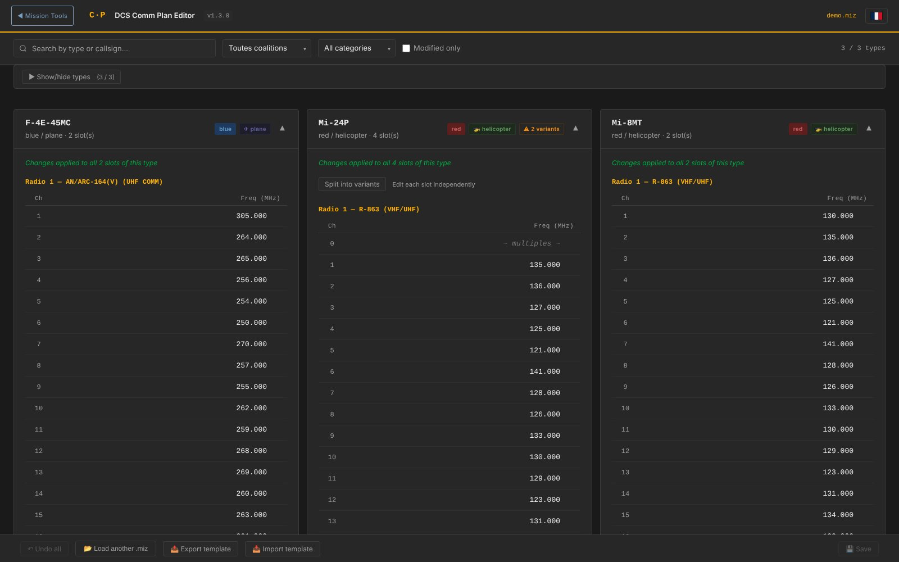
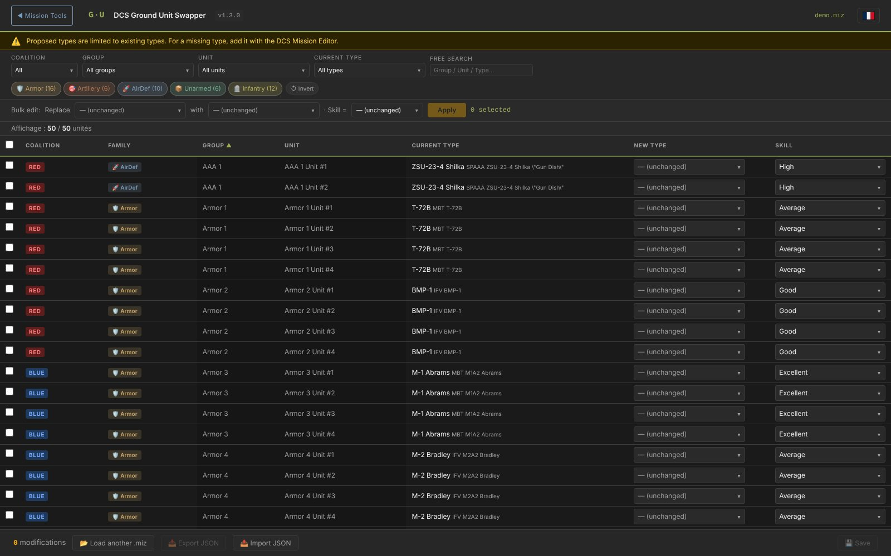
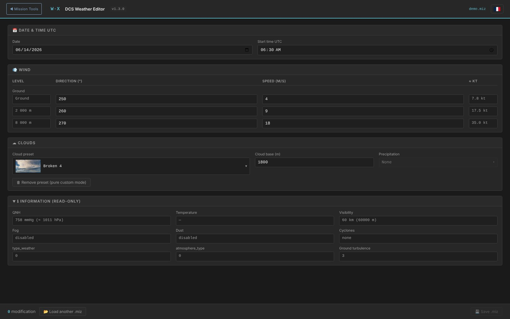
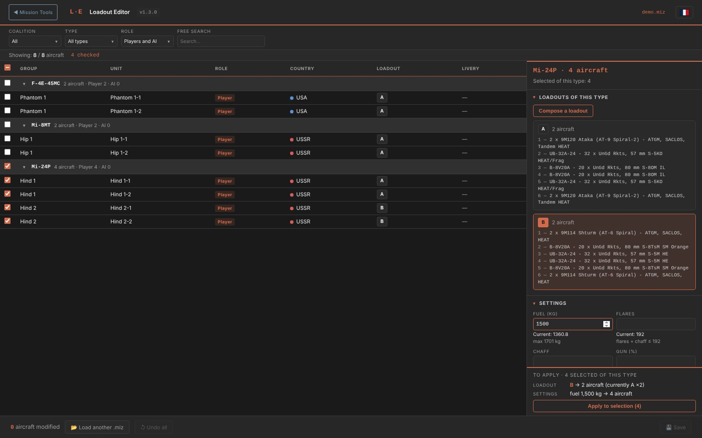
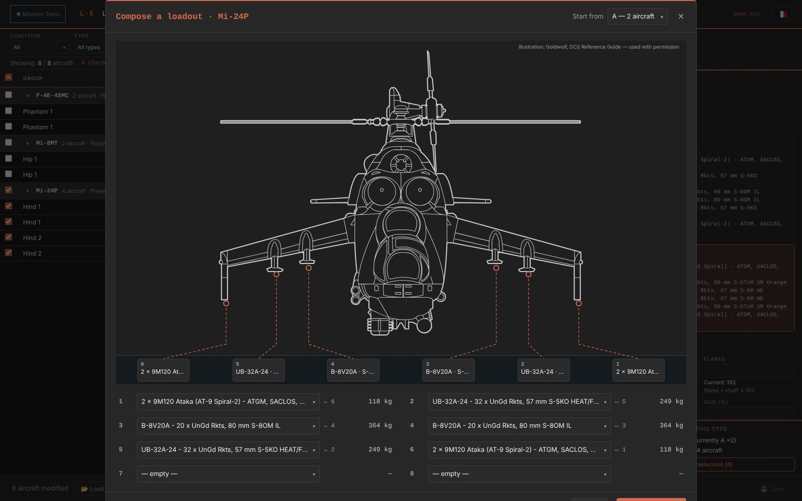

# DCS Mission Tools



> Edit your DCS World mission files surgically — four editors in one offline page. **Download a single file, drop a `.miz`, edit, save.**

    

> Aircraft, weapon and radio data come from **[pydcs](https://github.com/pydcs/dcs)** (LGPL-3.0-or-later) — many thanks to its authors.

🌐 **[Use it online »](https://mirabellebenou.github.io/dcs-mission-tools/)** · 💾 **[Download the offline file »](https://github.com/MirabelleBenou/dcs-mission-tools/releases)**

A single-page **workshop** that bundles a suite of surgical `.miz` editors for DCS World virtual pilots and wings. It runs entirely in your browser — **online for those who don't want to download**, or as **one offline HTML file** you can keep, share, and use without internet. Drop a `.miz`, edit it, save — the mission **never leaves your machine**, and your original is left untouched.

Developped with the help of Claude AI (I'm not a dev !)

---

## 📱 Built for the tablet (and your phone)

Mission Tools is designed to be used **where you actually fly** — on a tablet next to your stick, or on your phone. Editing your mission shouldn't mean alt-tabbing out of the cockpit.

- **Touch-first UI** — large tap targets, drag-and-drop the `.miz`, no tiny desktop-only controls
- **Responsive layout** — adapts from desktop down to phone
- **Rotation-safe** — keeps working when you flip the tablet between landscape and portrait
- **No install** — open a link or a single file in the mobile browser; works offline once loaded
- **Edit on the go** — drop a `.miz`, edit, and save a new one straight from the device

## 🔒 Local-first & non-destructive

Mission Tools edits the **actual mission file**, with surgical precision and nothing sent anywhere.

- **100% local** — JSZip is bundled in; the `.miz` is never uploaded
- **Surgical patching** — the `.miz` is patched in place, not rewritten from scratch
- **Strict preservation** — critical data is kept intact (groups/units are read-only so CTLD/MOOSE scripts don't break; the mission's companion files are preserved)
- **Non-destructive** — saving downloads a new `.miz`; your original stays as-is

## 🧰 The suite

The landing page presents each editor as a tile. Active tools open in place.

| Tool                            | What it does                                                                                                                | Status      |
| ------------------------------- | --------------------------------------------------------------------------------------------------------------------------- | ----------- |
| **Comm Plan Editor** (`C·P`)    | Edit the communications plan — radio frequencies and presets                                                                | ✅ `v1.4.0` |
| **Ground Unit Swapper** (`G·U`) | Bulk-swap ground unit types and skill, filtered by coalition / group / family                                               | ✅ `v1.4.0` |
| **Weather Editor** (`W·X`)      | Edit date/time, wind layers, clouds and precipitation — 34 presets                                                          | ✅ `v1.4.0` |
| **Loadout Editor** (`L·E`)      | Bulk-apply aircraft loadouts and liveries to many aircraft at once                                                          | ✅ `v1.4.0` |

> The tools live in one self-contained page, which shares a single working `.miz` between them; a tool file opened on its own only points to Mission Tools.

### 📡 Comm Plan Editor — in detail

The Comm Plan Editor reads your mission's **communications plan** and lets you edit **radio frequencies and presets** with surgical precision.

- **Lua-aware** — full tokenizer → AST parser → model extraction → in-place patch pipeline
- **Surgical patching** — only the edited values are rewritten; the rest of the `.miz` is left byte-for-byte intact
- **Companion files preserved** — scripts, kneeboards and other embedded files are kept
- **Bilingual FR / EN**, choice remembered

### 🪖 Ground Unit Swapper — in detail

The Ground Unit Swapper lets you **bulk-swap ground unit types and skill** across the mission, with powerful filtering — handy for re-theming a mission or adjusting threat density.

- **Filter** by coalition, group and **family** — Armor, Artillery, **AirDef** (SAM + AAA), Radar / EWR, **Unarmed** (logistics + infrastructure / C2), Infantry
- **Swap by type** — change unit types in bulk; livery is preserved
- **Skill editable** — Average / Good / High / Excellent
- **Safe by design** — `Client` / `Player` units excluded; **group and unit names are strictly read-only** so CTLD / MOOSE / scripted logic keeps working
- **Bilingual FR / EN**, choice remembered

### 🌦️ Weather Editor — in detail

The Weather Editor gives you full control over **mission weather**, from a quick preset to a fully custom setup.

- **Date & time** (UTC), **wind on 3 layers**, **clouds** (preset / base / precipitation)
- **34 presets** with thumbnails
- **Handles both** preset-based and fully custom weather structures
- **Read-only context** for derived values (QNH, temperature, visibility…) so nothing inconsistent is written
- **Bilingual FR / EN**, choice remembered

### 🎯 Loadout Editor — in detail

The Loadout Editor **applies a loadout that already exists in the mission** — and a livery — to many aircraft at once, players and AI alike. Handy when a large mission holds hundreds of aircraft and the Mission Editor only sets them one by one.

- **Copy an existing loadout** to every selected aircraft of the same type (players and AI) — a loadout is its pylons, shown by weapon name, lettered A, B, C… when the file is opened
- **Pick, then apply** — click a loadout or a livery card, check the bar at the bottom of the panel (it says how many aircraft change and what they carry now), then press *Apply*
- **Fuel, flares, chaff and gun in bulk** — an empty field changes nothing; each field shows the current value of the checked aircraft and the type's limit, and a value above the limit is refused
- **Liveries** applied within the same type and country
- **Written back safely** — each payload is replaced whole, then re-read and verified before the download is offered
- **Bilingual FR / EN**, choice remembered

## ✨ Features

- **Fully offline** — one HTML file, no install, no server, no internet
- **One page, four editors** — bundled tiles, a single working `.miz` shared between tools
- **Shared working file** — the same `.miz` flows from one tool to the next; edits accumulate until you save
- **Surgical, non-destructive** — patched in place; a new `.miz` is downloaded, the original is untouched
- **Strict preservation** — read-only groups/units, kept companion files
- **Bilingual** — full FR / EN toggle, choice remembered

## 📸 Screenshots

**The board** — four editors on one offline page, FR/EN


**Comm Plan Editor** — every flight's radios and presets, channels numbered as in the cockpit



**Ground Unit Swapper** — filter by coalition, group and family, then swap types and skill in bulk



**Weather Editor** — date and time, wind layers, clouds and precipitation, 34 presets



**Loadout Editor** — loadouts by letter, settings and livery applied to the selection in one click



**Loadout Editor · Compose a loadout** — station by station, on a front view of the aircraft



<sub>Front-view drawing: Goldwolf, DCS Reference Guide — used with permission, not covered by the AGPL licence. Screenshots taken on a generic demo mission.</sub>

## 🚀 Quick Start

**Option A — online (nothing to download)**

1. Open **[the hosted version](https://mirabellebenou.github.io/dcs-mission-tools/)** in your browser (works on phone/tablet too)
2. Pick a tool, drop a `.miz`, and edit

**Option B — offline file**

1. Download the latest `dcs_mission_tools.html` from the [Releases](https://github.com/MirabelleBenou/dcs-mission-tools/releases) page
2. Open it in any modern browser (Chrome recommended) — on PC or tablet
3. Pick a tool, **drop a `.miz`** and edit

In both cases, **Save** downloads a new `.miz` (your original is left untouched).

> Tip: always keep a backup of your missions before editing. No account, no internet required after the first load.

## 📓 Changelog

See [CHANGELOG.md](https://github.com/MirabelleBenou/dcs-mission-tools/blob/main/CHANGELOG.md) for the per-tool version history.

## 🏗️ Building from source

The page is **built**, not hand-written: `build_mission_tools.py` reads the module sources and tiles, base64-encodes them, and produces the single file.

### Prerequisites

- Python 3.8+ (standard library only)

### Build

```
python3 build_mission_tools.py        # → dist/dcs_mission_tools.html
```

The module sources are read from `modules/` and the output is written to `dist/dcs_mission_tools.html`, the distributable (and the file published on Releases). The version shown on each tool's card is read from the tool's own `APP_VERSION` at build time.

`docs/index.html` (the hosted page) is a byte-for-byte copy of `dist/dcs_mission_tools.html`, made at each milestone.

### Project structure

```
.
├── build_mission_tools.py     # shell + bundler (embeds modules + tiles)
├── modules/                   # the four tools, bundled by the build (source of truth)
│   ├── dcs_comm_plan_editor.html
│   ├── dcs_ground_unit_swapper.html
│   ├── dcs_weather_editor.html
│   └── dcs_loadout_editor.html
├── tiles/                     # landing tiles (512² WebP): cp, gu, wx, le
├── data/                      # weapon names and aircraft limits (from pydcs, LGPL-3.0-or-later) and their licence
├── tools/                     # gen_weapon_names.py, gen_aircraft_limits.py — regenerate the data/ tables
├── dist/                      # built output: dcs_mission_tools.html
├── CHANGELOG.md
├── README.md
└── LICENSE
```

> The **source of truth** is each module in `modules/` (never the built file); the modules run only inside the built page. Filenames carry **no version** — versioning lives in GitHub tags / releases.

## 🗺️ Roadmap

- ⏳ **UI polish** across shell and tools

## 🤝 Contributing

Bug reports and feature suggestions are welcome via the [Issues](https://github.com/MirabelleBenou/dcs-mission-tools/issues) page.

For code contributions: fork, branch, study the build script to understand the architecture, test by rebuilding and opening the result in a browser, then open a pull request.

## ⚠️ Compatibility

- **Chrome / Edge** (recommended): all features
- **Firefox / Brave**: supported
- **Mobile browsers** (Android / iOS): supported and a first-class target — touch, drag, rotation

## 📄 License

[GNU AGPL-3.0-or-later](https://github.com/MirabelleBenou/dcs-mission-tools/blob/main/LICENSE) — free to use, modify and share, commercial use included (a paid service too), **provided the source code of your version is published under the same licence**, hosted services included (section 13). Every interface must keep the credit line “Based on Mission Tools by MirabelleBenou and the 4th VEAW virtual wing” (an additional term under section 7(b), see `LICENSE`). Releases up to v1.3.0 remain under the MIT licence. Exceptions: the front-view drawings (by Goldwolf, `data/views/LICENSE.md`) and the pydcs-derived tables (LGPL-3.0-or-later, `data/COPYING.LESSER`).

Roboto Mono is embedded under the Apache License 2.0 (Google Fonts).

## 🙏 Acknowledgments

- Built for the DCS World virtual aviation community
- **[pydcs](https://github.com/pydcs/dcs)** 1.0.0 (LGPL-3.0-or-later) is the source of the suite's aircraft data: weapon names, stations and limits in the Loadout Editor, aircraft types and the default radio channels that check the Comm Plan Editor's frequency bands — the tables and their licence are in [`data/`](data/)
- Front-view drawings in `data/views/`: Goldwolf, DCS Reference Guide — used with permission, not covered by the AGPL licence.
- Initial version developed for the **4th VEAW** virtual wing — distributed as generic, public tools
- A companion to **[DCS Mission Plan](https://github.com/MirabelleBenou/dcs-mission-plan)** (briefings, recon, HQ)

---

*This project is not affiliated with or endorsed by Eagle Dynamics, the developers of DCS World.*
